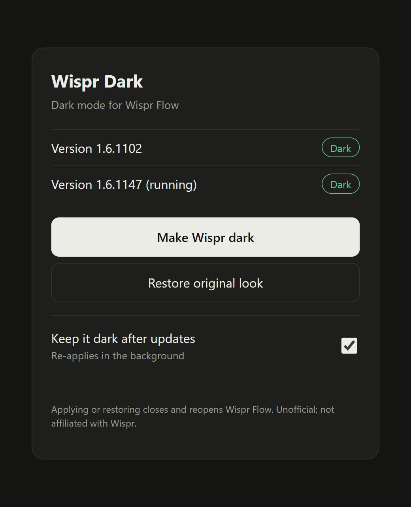

# Wispr Dark

Dark mode for [Wispr Flow](https://wisprflow.ai) on Windows. Download, double-click, one button.

<p align="center"></p>

> **Unofficial.** Not affiliated with or endorsed by Wispr. It edits Wispr Flow's local app files on your PC, so use it at your own risk. Your originals are backed up, and one click restores them.

## How to use

1. Download **Wispr-Dark.exe** from the [latest release](../../releases/latest).
2. Double-click it. A black window and a page in your browser open.
3. Click **Make Wispr dark**. Wispr Flow restarts and is dark.

Keep the black window open while you use the page. Close it when you're done.

Windows may say "Windows protected your PC" because the file isn't code-signed. Click **More info**, then **Run anyway**. You can compare the file with the `Wispr-Dark.exe.sha256` checksum on the release page, or build it yourself from source (below).

### What the buttons do

| Button | What happens |
| --- | --- |
| **Make Wispr dark** | Quits Wispr Flow, applies the theme, reopens it. |
| **Restore original look** | Puts the original files back and reopens Wispr Flow. |
| **Keep it dark after updates** | Wispr updates reset the theme. This re-applies it automatically, checking every 30 minutes while you're logged in. It keeps a copy of the app in `%LOCALAPPDATA%\WisprDark` and adds a Windows scheduled task called `WisprDarkPatch`. Switch it off to remove the task. |

## FAQ

**Is it safe?** It only adds a small stylesheet to Wispr's own pages. Nothing is sent anywhere and no network ports are opened (the page only listens on your own computer). The original file is saved as `app.asar.orig` next to the patched one.

**Wispr updated and went light again.** Updates install a fresh copy. Turn on *Keep it dark after updates*, or run the app and click **Make Wispr dark** again.

**Some images or colours look off.** The theme inverts colours and flips images back, so it works without knowing Wispr's internals. A few photos or coloured artwork can look slightly different.

**It says Wispr Flow isn't installed.** Install Wispr Flow for your Windows user and open it once, then reload the page.

**Will my antivirus complain?** Possibly. The exe is unsigned and it modifies another program's files. That is exactly what it does, and all the source is in this repo.

**How do I remove it?** Click **Restore original look**, switch off **Keep it dark after updates**, then delete the exe (and `%LOCALAPPDATA%\WisprDark` if you used auto mode).

## How it works

Wispr Flow is an Electron app. Wispr Dark adds a dark stylesheet to the app's renderer pages inside `app.asar`, so it is dark however you open Wispr. No debug ports and no always-on background process. Details are in [`src/core.js`](src/core.js).

## Command line

The exe also works from a terminal:

```bash
Wispr-Dark.exe apply --restart     # make dark (quits and reopens Wispr)
Wispr-Dark.exe restore --restart   # original look
Wispr-Dark.exe status
Wispr-Dark.exe auto on             # or: auto off
Wispr-Dark.exe --version
```

## Build from source

Needs [Node.js](https://nodejs.org) 22 or newer.

```bash
npm install
node bin/wispr-dark.js ui       # run without building
npm run build:exe               # builds dist/Wispr-Dark.exe
```

## Releasing (maintainers)

1. Update `version` in `package.json` and add an entry to `CHANGELOG.md`.
2. `npm run build:exe`
3. Create a SHA-256 file: `(Get-FileHash dist/Wispr-Dark.exe).Hash.ToLower() + "  Wispr-Dark.exe" | Set-Content dist/Wispr-Dark.exe.sha256`
4. Tag and publish: `git tag vX.Y.Z`, push the tag, then `gh release create vX.Y.Z dist/Wispr-Dark.exe dist/Wispr-Dark.exe.sha256 --notes-file CHANGELOG.md`

## License

[MIT](LICENSE)
